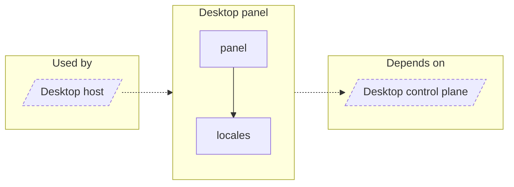

<!-- Generated by `task atlas:generate` from docs/atlas and source. Do not edit. -->

# Desktop panel

_architecture · source: `derived: atlas.yaml group desktop-panel + imports`_

The Settings window as native UI drawn by MyGo: its view state, the draft that is the one save boundary, operation tracking, and the message catalogs every string a person reads comes from. It calls the control plane through the validating service facade and never a controller.

## Elements

| Element | Description | Anchor |
| --- | --- | --- |
| Desktop host |  | `group:desktop-host` |
| locales | Package locales holds every string a person reads in the Desktop App: the Settings window, the tray, and the window title. | `mod:desktop/internal/locales` [`desktop/internal/locales/doc.go`](../../../../desktop/internal/locales/doc.go) |
| panel | Package panel is the Desktop Settings window, drawn as native UI with github.com/egoist/mygo/ui: there is no webview, HTML, or JavaScript. | `mod:desktop/internal/panel` [`desktop/internal/panel/doc.go`](../../../../desktop/internal/panel/doc.go) |
| Desktop control plane |  | `group:desktop-control` |
