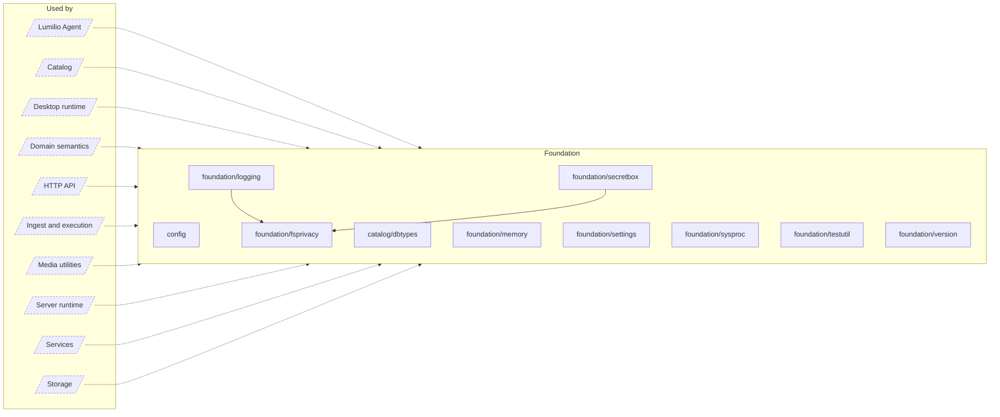

<!-- Generated by `task atlas:generate` from docs/atlas and source. Do not edit. -->

# Foundation

_architecture · source: `derived: atlas.yaml group foundation + imports`_

Dependency-free primitives every layer may use: the strict TOML configuration loader, runtime-mutable settings types, logging, version, catalog value types, secret sealing, memory and process helpers, and the owner-only filesystem policy. Nothing here knows about Assets, repositories, or HTTP.

## Elements

| Element | Description | Anchor |
| --- | --- | --- |
| Lumilio Agent |  | `group:agent` |
| Catalog |  | `group:catalog` |
| Desktop runtime |  | `group:desktop-runtime` |
| Domain semantics |  | `group:domain` |
| HTTP API |  | `group:http` |
| Ingest and execution |  | `group:ingest` |
| Media utilities |  | `group:media` |
| Server runtime |  | `group:runtime` |
| Services |  | `group:service` |
| Storage |  | `group:storage` |
| config | Package config is the strict runtime-immutable configuration boundary. | `mod:server/config` [`server/config/doc.go`](../../../../server/config/doc.go) |
| catalog/dbtypes | Package dbtypes holds the value types the catalog persists in JSON and text columns: [AssetType], per-type metadata ([PhotoSpecificMetadata], [VideoSpecificMetadata], [AudioSpecificMetadata]), ML result payloads (faces, OCR, classification), [StackKind], vectors, and nullable collection types. | `mod:server/internal/catalog/dbtypes` [`server/internal/catalog/dbtypes/doc.go`](../../../../server/internal/catalog/dbtypes/doc.go) |
| foundation/fsprivacy | Package fsprivacy applies owner-only filesystem access policies using the native mechanism of the host operating system. | `mod:server/internal/foundation/fsprivacy` [`server/internal/foundation/fsprivacy/doc.go`](../../../../server/internal/foundation/fsprivacy/doc.go) |
| foundation/logging | Package logging builds the process logger. | `mod:server/internal/foundation/logging` [`server/internal/foundation/logging/doc.go`](../../../../server/internal/foundation/logging/doc.go) |
| foundation/memory | Package memory adapts upload behaviour to host memory. | `mod:server/internal/foundation/memory` [`server/internal/foundation/memory/doc.go`](../../../../server/internal/foundation/memory/doc.go) |
| foundation/secretbox | Package secretbox seals small application secrets (cloud credentials and encrypted settings values) with AES keys derived per scope from one root secret. | `mod:server/internal/foundation/secretbox` [`server/internal/foundation/secretbox/doc.go`](../../../../server/internal/foundation/secretbox/doc.go) |
| foundation/settings | Package settings defines the runtime-mutable settings domain: typed values whose single source of truth is the catalog settings row, changed through the Settings and Setup APIs, never through TOML. | `mod:server/internal/foundation/settings` [`server/internal/foundation/settings/doc.go`](../../../../server/internal/foundation/settings/doc.go) |
| foundation/sysproc | Package sysproc holds process-spawning helpers shared by media tools. | `mod:server/internal/foundation/sysproc` [`server/internal/foundation/sysproc/doc.go`](../../../../server/internal/foundation/sysproc/doc.go) |
| foundation/testutil | Package testutil seeds catalog fixtures for tests. | `mod:server/internal/foundation/testutil` [`server/internal/foundation/testutil/doc.go`](../../../../server/internal/foundation/testutil/doc.go) |
| foundation/version | Package version carries the product version stamped at build time: | `mod:server/internal/foundation/version` [`server/internal/foundation/version/doc.go`](../../../../server/internal/foundation/version/doc.go) |
