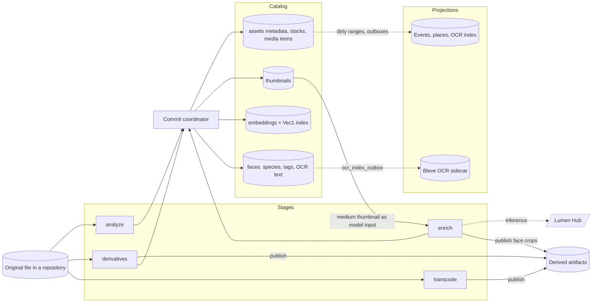

<!-- Generated by `task atlas:generate` from docs/atlas and source. Do not edit. -->

# Asset processing — from original to searchable

_dataflow · source: `docs/atlas/views/dataflow/asset-processing.yaml`_

What each pipeline stage reads and what it produces. The original file is only ever read. Stages are independent desired/applied pairs, so a missing ML service delays enrichment without blocking metadata, thumbnails, or browsing.

## Elements

| Element | Description | Anchor |
| --- | --- | --- |
| Original file in a repository | Resolved to a present entry just before I/O; never rewritten. | `go:server/internal/storage.RepositoryFS` [`server/internal/storage/repository_fs.go`](../../../../server/internal/storage/repository_fs.go) |
| analyze | exiftool and ffprobe metadata, capture time, GPS, component relations. | `go:server/app.pipelineRuntime.analyze` [`server/app/pipeline_runtime.go`](../../../../server/app/pipeline_runtime.go) |
| derivatives | Thumbnail ladder, video frames, audio artwork (libvips, LibRaw). | `go:server/app.pipelineRuntime.derivatives` [`server/app/pipeline_runtime.go`](../../../../server/app/pipeline_runtime.go) |
| transcode | Browser-playable video and audio renditions (ffmpeg). | `go:server/app.pipelineRuntime.transcode` [`server/app/pipeline_runtime.go`](../../../../server/app/pipeline_runtime.go) |
| enrich | pHash, semantic embedding, BioCLIP, OCR, faces, zero-shot tags, video frames. | `go:server/app.pipelineRuntime.enrich` [`server/app/pipeline_runtime.go`](../../../../server/app/pipeline_runtime.go) |
| Lumen Hub |  | `go:service.LumenService` [`server/internal/service/lumen_service.go`](../../../../server/internal/service/lumen_service.go) |
| Derived artifacts | Immutable files under the repository's .lumilio area. | `go:artifact.Store` [`server/internal/storage/artifact/store.go`](../../../../server/internal/storage/artifact/store.go) |
| Commit coordinator |  | `go:commit.Coordinator` [`server/internal/ingest/commit/coordinator.go`](../../../../server/internal/ingest/commit/coordinator.go) |
| assets metadata, stacks, media items |  | `sql:media_items` [`server/migrations/000001_storage_baseline.up.sql`](../../../../server/migrations/000001_storage_baseline.up.sql) |
| thumbnails |  | `sql:thumbnails` [`server/migrations/000001_storage_baseline.up.sql`](../../../../server/migrations/000001_storage_baseline.up.sql) |
| embeddings + Vec1 index |  | `sql:search_embeddings` [`server/migrations/000001_storage_baseline.up.sql`](../../../../server/migrations/000001_storage_baseline.up.sql) |
| faces, species, tags, OCR text |  | `sql:face_items` [`server/migrations/000001_storage_baseline.up.sql`](../../../../server/migrations/000001_storage_baseline.up.sql) |
| Events, places, OCR index | Rebuilt in bounded, revision-fenced turns by projection jobs. | `sql:event_media_items` [`server/migrations/000001_storage_baseline.up.sql`](../../../../server/migrations/000001_storage_baseline.up.sql) |
| Bleve OCR sidecar |  | `go:bleveocr.Index` [`server/internal/search/bleveocr/index.go`](../../../../server/internal/search/bleveocr/index.go) |

## Anchored flows

| From → To | Label | Anchor |
| --- | --- | --- |
| thumbs → enrich | medium thumbnail as model input | `go:queue.NewDBMLImageLoader` [`server/internal/ingest/queue/ml_image_loader.go`](../../../../server/internal/ingest/queue/ml_image_loader.go) |
| derivatives → artifacts | publish | `go:processors.AssetProcessor.PublishThumbnailTask` [`server/internal/ingest/processors/thumbnail_task.go`](../../../../server/internal/ingest/processors/thumbnail_task.go) |
| transcode → artifacts | publish | `go:processors.AssetProcessor.PublishTranscodeTask` [`server/internal/ingest/processors/transcode_task.go`](../../../../server/internal/ingest/processors/transcode_task.go) |
| enrich → artifacts | publish face crops | `go:service.PublishFaceCrops` [`server/internal/service/face_service.go`](../../../../server/internal/service/face_service.go) |
| analyze → coordinator |  | `go:commit.Coordinator.ApplyAssetMetadata` [`server/internal/ingest/commit/typed_catalog.go`](../../../../server/internal/ingest/commit/typed_catalog.go) |
| derivatives → coordinator |  | `go:commit.Coordinator.ApplyAssetDerivatives` [`server/internal/ingest/commit/typed_catalog.go`](../../../../server/internal/ingest/commit/typed_catalog.go) |
| enrich → coordinator |  | `go:commit.Coordinator.ApplyEnrichment` [`server/internal/ingest/commit/typed_catalog.go`](../../../../server/internal/ingest/commit/typed_catalog.go) |
| faces → bleve | ocr_index_outbox | `go:bleveocr.Writer` [`server/internal/search/bleveocr/writer.go`](../../../../server/internal/search/bleveocr/writer.go) |

## Catalog rows name artifacts by identity

A thumbnail row and a face item store the artifact's source fence, pipeline version, and name; the table implies the stage. The layout package resolves the identity to a path under .lumilio/cache/artifacts/, so no catalog row holds a private path.

## Fences

Every result carries the source content it was computed from and the desired version it answers. If the file changed or a newer request arrived meanwhile, the coordinator records the result as stale and the scheduler derives the work again.

## Related views

- [Background work — desired state to applied state](../dataflow/background-work.md)
- [Browser upload to catalog Asset](../sequence/upload-to-catalog.md)
- [Library search (fused retrieval)](../sequence/library-search.md)
